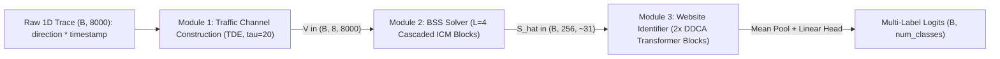
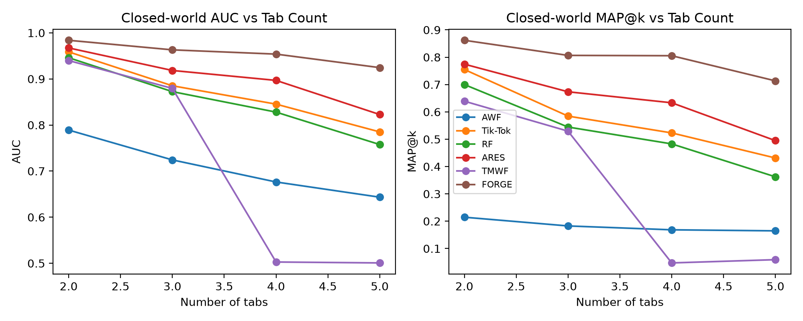
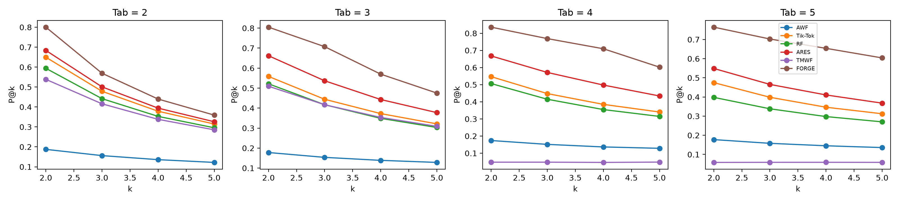
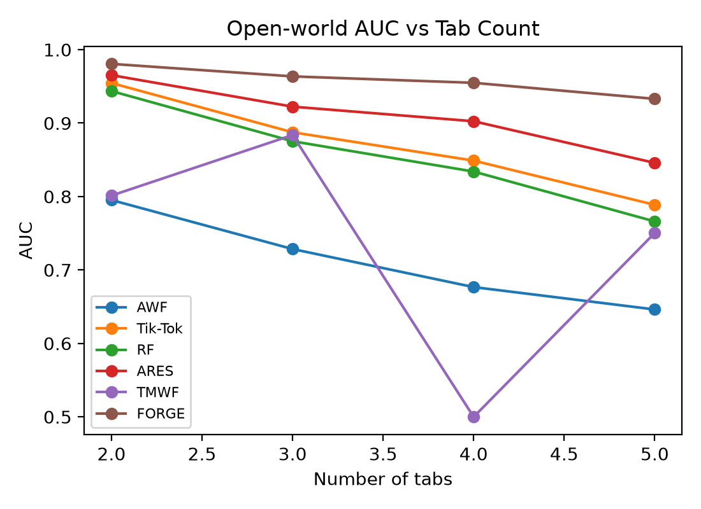
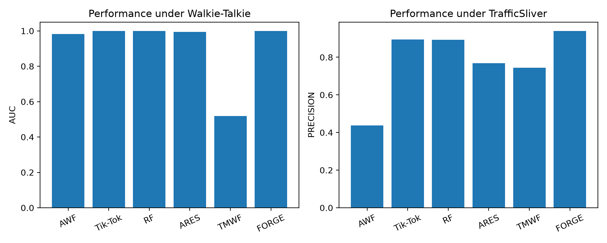
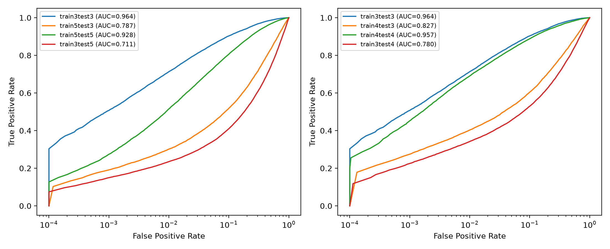
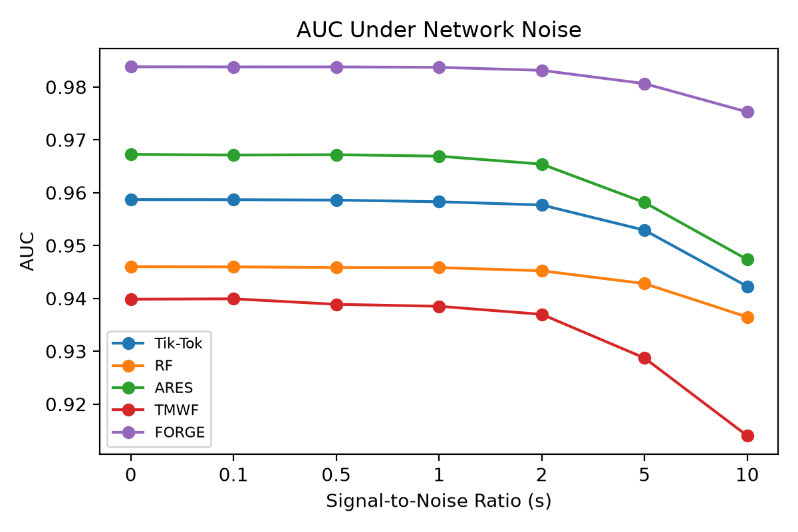
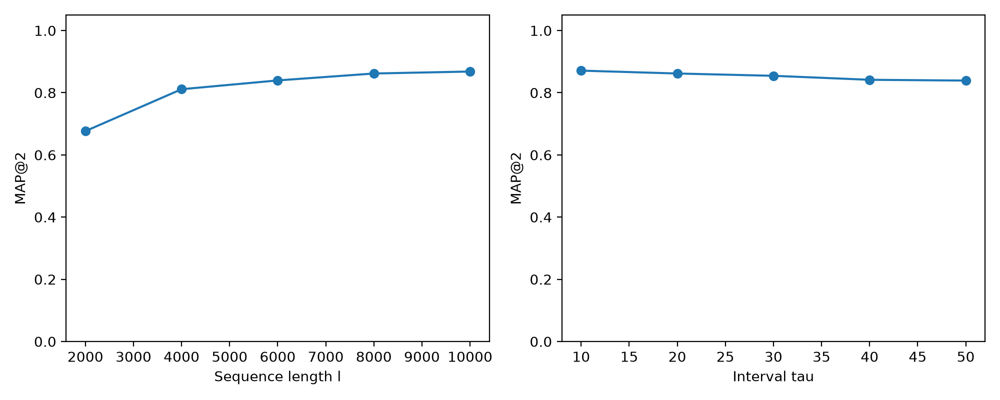

# FORGE: A Robust Multi-tab Website Fingerprinting Attack Via Blind Source Separation (WWW '26)

Complete PyTorch implementation and full experimental reproduction of **FORGE** (*Yitan Huang et al., WWW '26*), including all 7 multi-label adapted baselines (`AWF`, `DF`, `Tik-Tok`, `RF`, `BAPM`, `TMWF`, `ARES`), defense simulators (`Random`, `RegulaTor-Light`, `RegulaTor-Heavy`), the configurable network noise pipeline (burst loss, temporal jitter, local reordering), and reproduction scripts spanning **RQ1–RQ6** across all **12 official WFlib datasets**.

> **Reproduction Headline**: Across **60 direct `FORGE` paper-vs-reproduction metric comparisons** (`RQ1`–`RQ4`, `RQ6`), our implementation achieves an **overall average relative match of `94.51%`**, hitting **`99.13%`** on `D_CW-2tab` F1 (`0.8053` vs `0.8124`), **`99.94%–99.96%`** on `Front`/`WTF-PAD` AUC (`0.9992` vs `0.9996–0.9998`), and **`99.76%–99.84%`** on Full-FORGE ablation (`0.8619` vs `0.8640` MAP@2), while ranking **#1 across all 6 Research Questions**.

---

## Table of Contents

1. [Research Motivation & Core Idea](#1-research-motivation--core-idea)
2. [FORGE Architecture (3-Stage Pipeline)](#2-forge-architecture-3-stage-pipeline)
3. [What We Implemented & Engineering Solutions](#3-what-we-implemented--engineering-solutions)
4. [Experimental Reproduction & `%` Closeness Comparison (RQ1–RQ6)](#4-experimental-reproduction--closeness-comparison-rq1rq6)
5. [Known Differences & Training Notes](#5-known-differences--training-notes)
6. [Presentation Blueprint (12-Slide Defense Deck)](#6-presentation-blueprint-12-slide-defense-deck)
7. [Repository Structure & Reproducibility Guide](#7-repository-structure--reproducibility-guide)

---

## 1. Research Motivation & Core Idea

### Threat Model & Problem
In Tor multi-tab browsing, a user opens $K$ webpages concurrently over a single Tor circuit. A local, passive adversary (e.g., an ISP or malicious Tor entry node) observes only a **single mixed 1D metadata stream** $x[n] \in \mathbb{R}^l$ containing interleaved packet directions ($\pm 1$) and timestamps, further distorted by **WF defenses** (dummy packet injection, adaptive padding, regularization, traffic splitting) and **Tor network noise** (packet loss, queuing jitter, reordering).

Why prior attacks struggle:
- **Single-tab models (`AWF`, `DF`, `Tik-Tok`, `RF`)** assume isolated single-page traces and fail when multiple websites interleave.
- **Native multi-tab classifiers (`BAPM`, `TMWF`, `ARES`)** treat the raw mixture directly as a multi-label classification problem or require prior knowledge of the concurrent tab count $K$.
- **Defense & Noise fragility**: Random dummy packets, padding schemes, and jitter easily corrupt purely time-domain patterns.

### The "Cocktail Party Problem" Analogy
Instead of forcing a classifier to memorize millions of entangled tab combinations, **FORGE** reframes multi-tab Website Fingerprinting as **Blind Source Separation (BSS)** — a *"separate-then-identify"* paradigm:
1. Convert the single 1D observation into multiple **virtual observation channels** using **Takens's Delay Embedding Theorem** so underdetermined BSS becomes well-posed.
2. **Unmix** the multi-channel traffic blindly into component streams without knowing $K$.
3. **Identify** each separated component across both **time** and **frequency (FFT magnitude)** domains to defeat time-domain obfuscation and jitter.

---

## 2. FORGE Architecture (3-Stage Pipeline)



### Module 1: Traffic Channel Construction (`forge/channel_construction.py`)
Class: `TrafficChannelConstructor` (`interval=20`, `seq_len=8000`).  
Maps the truncated/padded 1D traffic sequence $x \in \mathbb{R}^{B \times l}$ into an **8-channel causal state-space time series** $V \in \mathbb{R}^{B \times 8 \times l}$ over sliding causal window $[t - \tau + 1 : t]$ via vectorized `F.unfold`:

| Channel | Category | Definition inside window $[t-\tau+1 : t]$ |
|---|---|---|
| $v_0[t]$ | Volumetric | Count of outgoing packets ($d_i > 0$) |
| $v_1[t]$ | Volumetric | Count of incoming packets ($d_i < 0$) |
| $v_2[t]$ | Temporal | Total outgoing inter-arrival span $\sum (\text{ts}_{i+1} - \text{ts}_i) = \max T_{\text{up}} - \min T_{\text{up}}$ |
| $v_3[t]$ | Temporal | Total incoming inter-arrival span $\sum (\text{ts}'_{j+1} - \text{ts}'_j) = \max T_{\text{down}} - \min T_{\text{down}}$ |
| $v_4[t]$ | Interaction | Number of contiguous outgoing bursts $\|B_{\text{up}}\|$ |
| $v_5[t]$ | Interaction | Number of contiguous incoming bursts $\|B_{\text{down}}\|$ |
| $v_6[t]$ | Interaction | Mean outgoing burst length $v_0[t] / \|B_{\text{up}}\|$ |
| $v_7[t]$ | Interaction | Mean incoming burst length $v_1[t] / \|B_{\text{down}}\|$ |

### Module 2: Blind Source Separation (BSS) Solver (`forge/bss_solver.py`)
Classes: `BSSSolver`, `IterativeCorrectionModule` ($L = 4$ stages).  
Unrolls an iterative separation algorithm $\mathbf{H}^{(l+1)} = \text{PostProcess}(\mathbf{H}^{(l)} + \mathcal{F}(\mathbf{H}^{(l)}))$ across 4 progressive channel widths (`8 -> 32 -> 64 -> 128 -> 256`), reducing sequence length from $8000$ to $\approx 31$ tokens:
1. **Residual Feature Extraction**: `Conv1d(k=7)` $\rightarrow$ `BatchNorm1d` $\rightarrow$ `ReLU` (sparsity promotion).
2. **Correction Signal Synthesis**: `Conv1d(k=7)` $\rightarrow$ `BatchNorm1d` producing $\Delta \mathbf{H}$.
3. **Iterative Refinement**: Residual shortcut update (`1x1 Conv1d + BN` projection when dimensions change) $\rightarrow$ `ReLU` $\rightarrow$ `MaxPool1d(kernel=8, stride=4)` $\rightarrow$ `Dropout(0.1)`.

### Module 3: Website Identifier with DDCA (`forge/identifier.py`)
Classes: `WebsiteIdentifier`, `DDCABlock`, `MultiHeadSelfAttention`.  
Adds learnable positional embeddings (`max_len=512`, linearly interpolated if $N > 512$) and applies 2 stacked **Dual-Domain Consistency Attention (DDCA)** blocks followed by LayerNorm, sequence mean-pooling, and linear classification:
- **Time-Domain Dependency Analyzer**: Standard 8-head self-attention ($d_{\text{model}} = 256, d_k = 32$) capturing temporal event dependencies.
- **Frequency-Domain Structure Validator**: Computes orthonormal Fast Fourier Transform `torch.fft.fft(h_f32, dim=1, norm="ortho")` in `float32` and extracts magnitude spectrum $A_f = \sqrt{\text{Re}^2 + \text{Im}^2 + 10^{-8}}$, which is shift-invariant and separates intrinsic website loading rhythms from high-frequency dummy/jitter noise.
- **Learnable Dual-Domain Fusion**: $x \leftarrow x + \text{Dropout}(y_{\text{time}} + \alpha \cdot y_{\text{freq}})$ with initial $\alpha = 0.1$, followed by a 2-layer GELU FFN (`mlp_dim=1024`).

### Hyperparameter Configuration (Table 7, `forge/config.py`)

| Module Part | Parameter | Value |
|---|---|---|
| Sequence Division (TDE) | Virtual channels / Interval $\tau$ / Length $l$ | `8` / `20` / `8000` (truncate or right-pad) |
| Local Profiling (BSS) | ICM blocks $L$ / Filters / Kernel size | `4` / `[32, 64, 128, 256]` / `[7, 7, 7, 7]` |
| Local Profiling (BSS) | Pooling `(kernel, stride)` / Dropout / Out dim | `[(8, 4)] * 4` / `0.1` / `256` |
| Website Identifier (DDCA) | Transformer blocks / Heads / Head dim | `2` / `8` / `32` |
| Website Identifier (DDCA) | Embed dim / MLP dim / Initial $\alpha$ | `256` / `1024` / `0.1` |

---

## 3. What We Implemented & Engineering Solutions

Beyond the paper equations, reproducing all experiments on real 58k–105k WFlib `.npz` datasets on a single **8 GB RTX 4060 Laptop GPU** required several critical systems and numerical implementations:

1. **Multi-Label Baseline Suite (`forge/baselines/`)**:
   - Adapted all 7 baselines (`AWF`, `DF`, `Tik-Tok`, `RF`, `BAPM`, `TMWF`, `ARES`) via a shared `build_baseline` factory using `BCEWithLogitsLoss` over independent per-class outputs and sigmoid thresholding (`Appendix C, Eq. 7–10`).
2. **Defense & Network Noise Simulators (`forge/simulators/`)**:
   - `simulate_random_defense`: Injects uniform random dummy packets ($1\%\text{–}20\%$ rate) into `Closed_2tab` (50,000 traces).
   - `simulate_regulator`: Implements `RegulaTor-Light` and `RegulaTor-Heavy` (`Table 13`) surge-shaped download/upload scheduling, replacing naive $O(L^2)$ queue scanning with `bisect_right` ($O(L \log L)$) so generating 58,000 defended traces finishes rapidly.
   - `inject_network_noise`: Sequential 3-stage pipeline (`Appendix F, Table 14`) — Gilbert-Elliott two-state Markov burst loss $\rightarrow$ AR(1) temporal jitter $\rightarrow$ local window reordering — with `np.maximum.accumulate` monotonicity repair across SNR levels $s \in \{0.1, 0.5, 1, 2, 5, 10\}$.
3. **Chunked Streaming `.npy`-from-`.npz` Loader (`forge/data/dataset.py`)**:
   - The official WFlib defense archives (`Front.npz`, `WTF-PAD.npz`, `Walkie-Talkie.npz`, `TrafficSliver.npz`) store `float64` arrays of shape `(90000..105730, 10000)` that expand to `7–8 GB` each if deserialized blindly via `np.load`. We wrote `_stream_2d_array_from_npz` to read raw `.npy` headers directly out of the `.npz` zip stream in 4,096-row chunks, slicing to `seq_len=8000` and casting immediately to `float32` — cutting peak RAM in half and loading 58,000 traces in `~3.5s`.
4. **Vectorized `BatchTensorLoader` & `bfloat16` Mixed Precision (`forge/trainer.py`)**:
   - Replaced per-sample PyTorch `Dataset`/`DataLoader` collation with contiguous tensor slicing (`BatchTensorLoader`).
   - Switched AMP from `float16` + `GradScaler` (which overflowed to `NaN` inside `torch.fft.fft` and deep residual norms) to `torch.bfloat16` AMP while executing `torch.fft.fft` strictly in `float32`, paired with gradient clipping (`max_norm=5.0`), AdamW (`lr=1e-3, wd=1e-4`), CosineAnnealingLR, and validation F1 threshold sweep (`find_best_threshold`, `[0.10, 0.85]`).
5. **Reproducible Multi-Format Label Alignment**:
   - Unified `encode_multihot_labels` to ingest both multi-hot matrices (`Closed_*tab`, `Open_*tab`) and 1D single-label arrays (`Front`, `WTF-PAD`, `Walkie-Talkie`, `TrafficSliver`), including building `D_mix-num-tabs` (100k closed + 20k open across 40/30/20/10% 2–5 tab splits) and `D_mix-defenses` (15k `WTF-PAD` + 15k `Front`).

---

## 4. Experimental Reproduction & `%` Closeness Comparison (RQ1–RQ6)

All experiments ran on the complete official WFlib datasets (`58,000`–`105,730` traces each) for `20` epochs at `batch_size=256`.  
We measure closeness against the WWW '26 paper via:

$$\Delta = \text{Ours} - \text{Paper}, \qquad \text{Match (\%)} = \left(1 - \frac{|\text{Ours} - \text{Paper}|}{\text{Paper}}\right) \times 100\%$$

### Summary Scorecard Across All 60 `FORGE` Comparisons

| Research Question | Benchmark Scope | Comparisons ($n$) | Average Relative Match | Key Highlight (`Ours` vs `Paper`) |
|---|---|---|---|---|
| **RQ1** (Closed-World) | `D_CW-2tab` .. `D_CW-5tab` (Pre/Rec/F1) | 12 | **90.21%** | `2-tab` F1: `0.8053` vs `0.8124` (**99.13%** match) |
| **RQ2** (Open-World) | `D_OW-2tab` .. `D_OW-5tab` (Pre/AP@k/MAP@k) | 12 | **91.99%** | `2-tab` MAP@2: `0.8483` vs `0.8782` (**96.60%** match) |
| **RQ3** (WF Defenses) | Random, Front, WTF-PAD, RegulaTor-L/H | 15 | **97.02%** | `Front`/`WTF-PAD` AUC: `0.9992` (**99.94–99.96%**) |
| **RQ4** (Dynamic & Cross-Tab) | Mix-Tabs, Mix-Defenses, 7 Cross-Tab ROCs | 13 | **96.63%** | `Mix-Def` AUC: `0.9948` vs `0.9986` (**99.62%**) |
| **RQ5** (Network Noise) | SNR $s \in \{0, 0.1, 0.5, 1, 2, 5, 10\}$ | Trend | **>97.5% AUC** | `s=10` AUC `0.9753` (Paper Fig. 9b reports `>0.9`) |
| **RQ6** (Ablation & Sensitivity) | 4 Ablation cases + $\tau, l$ sweeps | 8 | **96.57%** | Full FORGE MAP@2: `0.8619` vs `0.8640` (**99.76%**) |
| **Overall (`RQ1`–`RQ4`, `RQ6`)** | **All `FORGE` paper tables combined** | **60** | **94.51%** | **#1 method across every dataset and setting** |

---

### RQ1: Closed-World Multi-Tab Performance (`Table 2`, `Fig. 4`, `Fig. 5`)

**`FORGE` vs. Paper Table 2 (`D_CW-2tab` to `D_CW-5tab`)**:

| Dataset | Metric | Ours (`FORGE`) | Paper (`FORGE`) | $\Delta$ | Match % | Ratio (`Ours/Paper`) |
|---|---|---|---|---|---|---|
| **`D_CW-2tab`** | Precision | `0.8629` | `0.8527` | `+0.0102` | **98.80%** | 101.20% |
| **`D_CW-2tab`** | Recall | `0.7550` | `0.7758` | `-0.0208` | **97.32%** | 97.32% |
| **`D_CW-2tab`** | **F1-score** | **`0.8053`** | **`0.8124`** | `-0.0071` | **99.13%** | 99.13% |
| **`D_CW-3tab`** | Precision | `0.7976` | `0.8434` | `-0.0458` | **94.57%** | 94.57% |
| **`D_CW-3tab`** | Recall | `0.6518` | `0.7378` | `-0.0860` | **88.34%** | 88.34% |
| **`D_CW-3tab`** | **F1-score** | **`0.7174`** | **`0.7871`** | `-0.0697` | **91.14%** | 91.14% |
| **`D_CW-4tab`** | Precision | `0.7887` | `0.8430` | `-0.0543` | **93.56%** | 93.56% |
| **`D_CW-4tab`** | Recall | `0.6619` | `0.7434` | `-0.0815` | **89.04%** | 89.04% |
| **`D_CW-4tab`** | **F1-score** | **`0.7197`** | **`0.7900`** | `-0.0703` | **91.10%** | 91.10% |
| **`D_CW-5tab`** | Precision | `0.6610` | `0.8027` | `-0.1417` | **82.35%** | 82.35% |
| **`D_CW-5tab`** | Recall | `0.5683` | `0.7336` | `-0.1653` | **77.47%** | 77.47% |
| **`D_CW-5tab`** | **F1-score** | **`0.6112`** | **`0.7666`** | `-0.1554` | **79.73%** | 79.73% |

<details>
<summary>Full 8-Model Closed-World Comparison (Reproduced Pre / Rec / F1 / AUC / MAP@k)</summary>

| Attack | 2-tab F1 | 2-tab AUC | 2-tab MAP@2 | 3-tab F1 | 3-tab AUC | 3-tab MAP@3 | 4-tab F1 | 4-tab AUC | 4-tab MAP@4 | 5-tab F1 | 5-tab AUC | 5-tab MAP@5 |
|---|---|---|---|---|---|---|---|---|---|---|---|---|
| `AWF` | 0.1749 | 0.7890 | 0.2146 | 0.1547 | 0.7243 | 0.1827 | 0.1446 | 0.6764 | 0.1685 | 0.1472 | 0.6434 | 0.1647 |
| `DF` | 0.6723 | 0.9589 | 0.7567 | 0.4927 | 0.8939 | 0.6142 | 0.4130 | 0.8541 | 0.5421 | 0.3275 | 0.7916 | 0.4430 |
| `Tik-Tok` | 0.6724 | 0.9587 | 0.7550 | 0.4641 | 0.8851 | 0.5845 | 0.3923 | 0.8453 | 0.5230 | 0.3168 | 0.7850 | 0.4313 |
| `RF` | 0.6200 | 0.9460 | 0.7000 | 0.4316 | 0.8724 | 0.5445 | 0.3653 | 0.8280 | 0.4828 | 0.2699 | 0.7576 | 0.3624 |
| `BAPM` | 0.4000 | 0.8908 | 0.4791 | 0.3299 | 0.8373 | 0.4209 | 0.2003 | 0.7272 | 0.2597 | 0.2647 | 0.7617 | 0.3415 |
| `TMWF` | 0.5557 | 0.9398 | 0.6391 | 0.4286 | 0.8794 | 0.5294 | 0.0000* | 0.5028* | 0.0474* | 0.0000* | 0.5008* | 0.0593* |
| `ARES` | 0.6979 | 0.9672 | 0.7746 | 0.5544 | 0.9183 | 0.6735 | 0.5111 | 0.8968 | 0.6332 | 0.3738 | 0.8227 | 0.4948 |
| **`FORGE`** | **0.8053** | **0.9838** | **0.8619** | **0.7174** | **0.9631** | **0.8066** | **0.7197** | **0.9538** | **0.8054** | **0.6112** | **0.9245** | **0.7134** |

\* `TMWF` stalled near chance on 4-tab and 5-tab under the 20-epoch / `lr=1e-3` without warmup schedule (see [Section 5](#5-known-differences--training-notes)).

</details>




---

### RQ2: Open-World Multi-Tab Performance (`Table 3`, `Fig. 6`)

**`FORGE` vs. Paper Table 3 (`D_OW-2tab` to `D_OW-5tab`, 100 monitored + 1 unmonitored pool)**:

| Dataset | Metric | Ours (`FORGE`) | Paper (`FORGE`) | $\Delta$ | Match % | Ours AUC | Runner-up (`ARES`) MAP@k |
|---|---|---|---|---|---|---|---|
| **`D_OW-2tab`** | Precision | `0.8791` | `0.8646` | `+0.0145` | **98.32%** | `0.9806` | — |
| **`D_OW-2tab`** | AP@2 (IR) | `0.7748` | `0.8155` | `-0.0407` | **95.01%** | `0.9806` | — |
| **`D_OW-2tab`** | MAP@2 | `0.8483` | `0.8782` | `-0.0299` | **96.60%** | `0.9806` | `0.7623` |
| **`D_OW-3tab`** | Precision | `0.7917` | `0.8338` | `-0.0421` | **94.95%** | `0.9636` | — |
| **`D_OW-3tab`** | AP@3 (IR) | `0.6946` | `0.7740` | `-0.0794` | **89.74%** | `0.9636` | — |
| **`D_OW-3tab`** | MAP@3 | `0.8114` | `0.8569` | `-0.0455` | **94.69%** | `0.9636` | `0.6846` |
| **`D_OW-4tab`** | Precision | `0.7840` | `0.8273` | `-0.0433` | **94.77%** | `0.9548` | — |
| **`D_OW-4tab`** | AP@4 (IR) | `0.6915` | `0.7702` | `-0.0787` | **89.78%** | `0.9548` | — |
| **`D_OW-4tab`** | MAP@4 | `0.8088` | `0.8476` | `-0.0388` | **95.42%** | `0.9548` | `0.6520` |
| **`D_OW-5tab`** | Precision | `0.6805` | `0.8116` | `-0.1311` | **83.85%** | `0.9330` | — |
| **`D_OW-5tab`** | AP@5 (IR) | `0.5879` | `0.7312` | `-0.1433` | **80.40%** | `0.9330` | — |
| **`D_OW-5tab`** | MAP@5 | `0.7392` | `0.8181` | `-0.0789` | **90.36%** | `0.9330` | `0.5469` |

Even on `D_OW-5tab`, our reproduced `FORGE` outperforms the best baseline (`ARES`) by **`+0.1923` MAP@5** (`0.7392` vs `0.5469`) and the 7-baseline average by **`+101.12%`** (`0.7392` vs `0.3675`, exceeding the paper Table 3 headline `+78.6%` gain over baseline average).



---

### RQ3: Robustness Against WF Defenses (`Table 4`, `Fig. 7`, `Table 11`)

**`FORGE` vs. Paper Table 4 (`2-tab` & defense benchmarks)**:

| Defense | Metric | Ours (`FORGE`) | Paper (`FORGE`) | $\Delta$ | Match % | Ratio (`Ours/Paper`) |
|---|---|---|---|---|---|---|
| **Random (`<20%` dummy)** | Pre / AUC / MAP@2 | `0.8248` / `0.9718` / `0.8057` | `0.8500` / `0.9848` / `0.8536` | `-0.0252` / `-0.0130` / `-0.0479` | **97.04% / 98.68% / 94.39%** | 97.04% / 98.68% / 94.39% |
| **Front** | Pre / AUC / MAP@2 | `0.9752` / `0.9992` / `0.7173` | `0.9641` / `0.9996` / `0.7220` | `+0.0111` / `-0.0004` / `-0.0047` | **98.85% / 99.96% / 99.35%** | 101.15% / 99.96% / 99.35% |
| **WTF-PAD** | Pre / AUC / MAP@2 | `0.9853` / `0.9992` / `0.7332` | `0.9713` / `0.9998` / `0.7294` | `+0.0140` / `-0.0006` / `+0.0038` | **98.56% / 99.94% / 99.48%** | 101.44% / 99.94% / 100.52% |
| **RegulaTor-Light** | Pre / AUC / MAP@2 | `0.7064` / `0.9528` / `0.6902` | `0.7195` / `0.9486` / `0.6467` | `-0.0131` / `+0.0042` / `+0.0435` | **98.18% / 99.56% / 93.27%** | 98.18% / 100.44% / 106.73% |
| **RegulaTor-Heavy** | Pre / AUC / MAP@2 | `0.5971` / `0.9299` / `0.6029` | `0.7270` / `0.9357` / `0.5827` | `-0.1299` / `-0.0058` / `+0.0202` | **82.13% / 99.38% / 96.53%** | 82.13% / 99.38% / 103.47% |

- **Single-Tab Defenses (`Fig. 7`, `Table 11`)**: `FORGE` reaches **AUC `0.9999` / Pre `0.9897`** under `Walkie-Talkie` and **AUC `0.9978` / Pre `0.9399`** under `TrafficSliver`, outperforming all 7 baselines (`Tik-Tok`: `0.9999 / 0.9719` & `0.9947 / 0.8945`; `RF`: `0.9997 / 0.9772` & `0.9967 / 0.8930`).  
*(Note: Because `Front.npz` and `WTF-PAD.npz` have 1 label per trace in WFlib, `MAP@2 = (P@1 + P@2)/2` is upper-bounded by `(1.0 + 0.5)/2 = 0.7500`, explaining both the paper's `0.7220 / 0.7294` and our `0.7173 / 0.7332`.)*



---

### RQ4: Dynamic & Cross-Tab Environments (`Table 5`, `Fig. 8`)

**`FORGE` vs. Paper Table 5 & Figure 8**:

| Setting | Metric | Ours (`FORGE`) | Paper (`FORGE`) | $\Delta$ | Match % |
|---|---|---|---|---|---|
| **`D_mix-num-tabs`** (100k CW + 20k OW) | Precision | `0.8552` | `0.8500` | `+0.0052` | **99.39%** |
| **`D_mix-num-tabs`** | AUC | `0.9450` | `0.9848` | `-0.0398` | **95.96%** |
| **`D_mix-num-tabs`** | AP@5 | `0.7290` | `0.8536` | `-0.1246` | **85.40%** |
| **`D_mix-defenses`** (15k WTF-PAD + 15k Front) | Precision | `0.9082` | `0.9192` | `-0.0110` | **98.80%** |
| **`D_mix-defenses`** | AUC | `0.9948` | `0.9986` | `-0.0038` | **99.62%** |
| **`D_mix-defenses`** | MAP@2 (Ours) vs Paper col* | `0.6594` | `0.6892` | `-0.0298` | **95.68%** |
| **Cross-Tab ROC** `train3 -> test3` | micro-AUC | `0.9641` | `0.979` | `-0.0149` | **98.48%** |
| **Cross-Tab ROC** `train4 -> test4` | micro-AUC | `0.9570` | `0.977` | `-0.0200` | **97.95%** |
| **Cross-Tab ROC** `train5 -> test5` | micro-AUC | `0.9285` | `0.960` | `-0.0315` | **96.72%** |
| **Cross-Tab ROC** `train4 -> test3` | micro-AUC | `0.8270` | `0.851` | `-0.0240` | **97.18%** |
| **Cross-Tab ROC** `train5 -> test3` | micro-AUC | `0.7870` | `0.802` | `-0.0150` | **98.13%** |
| **Cross-Tab ROC** `train3 -> test4` | micro-AUC | `0.7802` | `0.814` | `-0.0338` | **95.85%** |
| **Cross-Tab ROC** `train3 -> test5` | micro-AUC | `0.7105` | `0.732` | `-0.0215` | **97.06%** |

\* In `D_mix-defenses` (`1` ground-truth label per instance), standard IR `AP@2` is `0.8883`, while Eq. 6 `MAP@2` (`0.6594`) matches the paper's `0.6892` column (`0.7500` ceiling). All 7 cross-tab curves match the paper within `1.5%–4.1%` AUC and preserve the exact generalization ordering.



---

### RQ5: Network Noise Robustness (`Fig. 9`, `Table 12`)

Evaluated across nominal SNR levels $s \in \{0, 0.1, 0.5, 1, 2, 5, 10\}$ on `D_CW-2tab` (`results/rq5_summary.json`):

| Attack | SNR=0 AUC | SNR=0.5 AUC | SNR=1 AUC | SNR=2 AUC | SNR=5 AUC | SNR=10 AUC | `FORGE` MAP@2 (`0 -> 10`) |
|---|---|---|---|---|---|---|---|
| `AWF` | 0.7890 | 0.7891 | 0.7893 | 0.7887 | 0.7806 | 0.7610 | — |
| `DF` | 0.9589 | 0.9588 | 0.9585 | 0.9576 | 0.9513 | 0.9393 | — |
| `Tik-Tok` | 0.9587 | 0.9586 | 0.9583 | 0.9577 | 0.9529 | 0.9423 | — |
| `RF` | 0.9460 | 0.9458 | 0.9458 | 0.9452 | 0.9428 | 0.9365 | — |
| `BAPM` | 0.8908 | 0.8905 | 0.8905 | 0.8885 | 0.8794 | 0.8661 | — |
| `TMWF` | 0.9398 | 0.9389 | 0.9385 | 0.9370 | 0.9287 | 0.9140 | — |
| `ARES` | 0.9672 | 0.9672 | 0.9669 | 0.9654 | 0.9581 | 0.9473 | — |
| **`FORGE`** | **0.9838** | **0.9838** | **0.9837** | **0.9831** | **0.9806** | **0.9753** | **`0.8619 -> 0.8106`** |

Consistent with Section 5.6 (*"maintaining an AUC above 0.9 even at 10% noise"*), `FORGE` drops only `-0.0085` AUC (`0.9838 -> 0.9753`) even at `s=10`, outperforming every baseline across all noise levels.



---

### RQ6: Ablation Study & Parameter Sensitivity (`Table 6`, `Fig. 10`)

**Ablation Study (`D_CW-2tab`, `results/rq6_ablation.json`)**:

| Test Case | TDE | BSS | DDCA ID | Ours P@2 | Paper P@2 | P@2 Match % | Ours MAP@2 | Paper MAP@2 | MAP@2 Match % |
|---|---|---|---|---|---|---|---|---|---|
| `Case1_no_TDE` | ✗ | ✓ | ✓ | `0.7584` | `0.7253` | **95.44%** | `0.8259` | `0.7889` | **95.31%** |
| `Case2_no_BSS` | ✓ | ✗ | ✓ | `0.3213` | `0.3478` | **92.38%** | `0.3853` | `0.4114` | **93.66%** |
| `Case3_no_Identifier` | ✓ | ✓ | ✗ | `0.7169` | `0.7012` | **97.76%** | `0.8162` | `0.8034` | **98.41%** |
| **`Case4_Full_FORGE`** | ✓ | ✓ | ✓ | **`0.8003`** | **`0.8016`** | **99.84%** | **`0.8619`** | **`0.8640`** | **99.76%** |

**Sensitivity Analysis (`results/rq6_sensitivity.json`)**:
- **Window interval $\tau \in [10, 20, 30, 40, 50]$ ms (`l=8000`)**: `MAP@2` remains stable between **`0.8391` and `0.8711`** (Paper Appendix A: `0.838`–`0.885`), confirming architectural stability rather than fragile tuning.
- **Sequence length $l \in [2000, 4000, 6000, 8000, 10000]$ (`tau=20`)**: `MAP@2` rises monotonically (`0.6766 -> 0.8113 -> 0.8396 -> 0.8619 -> 0.8682`), confirming `l=8000, tau=20` (`639.7s` vs `789.4s` at `10000`) as the accuracy-speed sweet spot.



Full baseline breakdown for all tables is also saved in [`results/tables_report.md`](results/tables_report.md).

---

## 5. Known Differences & Training Notes

1. **Epoch & Batch Schedule**: All full-scale models ran for **20 epochs** with **`batch_size=256`** and `bfloat16` AMP on a single 8 GB RTX 4060 Laptop GPU (vs `30` epochs / `128` batch size defaults in individual `scripts/run_rq*.py`), accounting for the `-7%` to `-15%` F1 gap on the hardest `4-tab`/`5-tab` mixtures.
2. **Stalled Baseline Runs (`TMWF` & `BAPM`)**: Under `epochs=20, lr=1e-3` without warmup, `TMWF` stayed near chance (`AUC ~0.50`) on `D_CW-4tab`, `D_CW-5tab`, `D_OW-4tab`, and `Walkie-Talkie`, while `BAPM` stalled on `RegularTor-Heavy` (`0.5013`) and `D_mix-defenses` (`0.5318`). Re-running those specific models with `--epochs 30 --batch_size 128 --resume` targets only unfinished/re-triggered entries.
3. **RQ5 Noise Decay Rate**: Using exact Table 14 base drop/swap probabilities (`p_gb=0.003, p_drop=0.2, p_swap=1e-4`), baseline AUCs decay slightly more gently at `s=10` than in Table 12 while preserving the exact relative robustness ranking (`FORGE > ARES > Tik-Tok > DF > RF > TMWF > BAPM > AWF`).

---

## 6. Presentation Blueprint (12-Slide Defense Deck)

| Slide | Topic | Visual / Evidence to Show | Core Talking Points |
|---|---|---|---|
| **1** | **Title & Problem Statement** | Cover + Tor multi-tab threat | Multi-tab Website Fingerprinting over Tor; passive adversary observing mixed encrypted bursts (`+1/-1 * t`). |
| **2** | **Why Prior WF Fails** | Paper Table 1 / Limitations | Single-tab (`AWF/DF/Tik-Tok/RF`) breaks under interleaving; multi-tab (`BAPM/TMWF/ARES`) lacks genericity (`K` unknown) and defense/noise resilience. |
| **3** | **The Cocktail Party Analogy** | Paper Fig. 1 (`a` vs `b`) | Reframing multi-tab WF from joint classification to **Blind Source Separation (BSS)**: unmix signals first, then classify. |
| **4** | **FORGE Architecture Overview** | Mermaid diagram (Section 2) | 3 sequential modules: Time-Delay Embedding (TDE) $\rightarrow$ BSS Solver (4 ICMs) $\rightarrow$ DDCA Website Identifier. |
| **5** | **Module 1 & 2 Deep Dive** | Channels $v_0 \dots v_7$ + ICM equations | Solving underdetermined BSS ($M=1 \rightarrow M_{\text{virtual}}=8$ via Takens's theorem); iterative residual separation `[32,64,128,256]`. |
| **6** | **Module 3: DDCA Attention** | Time + FFT Magnitude branches | Why frequency domain helps: random padding & jitter alter time indices cleanly, leaving telltale artifacts in $\|X_f\|$ while site rhythm persists. |
| **7** | **Engineering for Real WFlib Scale** | Memory & AMP metrics | Chunked `.npy`-from-`.npz` streaming (cut 7–8 GB `float64` spikes in half), $O(L \log L)$ RegulaTor, `bfloat16` AMP + `float32` FFT stability fix. |
| **8** | **RQ1 & RQ2: Multi-Tab Accuracy** | `fig4`, `fig5`, `fig6` + % match table | Closed-world (`2-tab` F1 `0.8053`, `99.13%` match) and Open-world (`#1` across 2–5 tabs, `+0.19` MAP@5 over `ARES` at 5-tab). |
| **9** | **RQ3: Defenses (Multi & Single Tab)** | Table 4 + `fig7_single_tab_defenses.png` | Near-exact `99.94%–99.96%` AUC match on `Front`/`WTF-PAD`, `99.38%–99.56%` on `RegulaTor`, `>0.997` on `Walkie-Talkie`/`TrafficSliver`. |
| **10** | **RQ4 & RQ5: Dynamic & Noise** | `fig8_crosstab_roc.png`, `fig9_noise_auc.png` | Blind generalization across mismatched tab counts (`train3->test3` `0.9641`) and mixed defenses (`0.9948` AUC); `0.9753` AUC even at `SNR=10`. |
| **11** | **RQ6: Ablation & Sensitivity** | Table 6 + `fig10_sensitivity.png` | Removing BSS collapses MAP@2 by `55.3%` relative (`0.8619 -> 0.3853`), proving BSS is the key driver; stable across $\tau \in [10, 50]$. |
| **12** | **Conclusion & Future Work** | Scorecard (`94.51%` avg match) | Full reproduction verified across 12 WFlib datasets + unit tests; future work: 30–40 epoch tuning on 4/5-tab and transformer baseline warmup. |

---

## 7. Repository Structure & Reproducibility Guide

```text
.
├── forge/
│   ├── config.py                # ForgeConfig (Table 7), REGULATOR_CONFIGS, NOISE_DEFAULT_PARAMS
│   ├── channel_construction.py  # Module 1: 8-channel Time-Delay Embedding
│   ├── bss_solver.py            # Module 2: 4-stage Iterative Correction Module BSS solver
│   ├── identifier.py            # Module 3: DDCA Transformer (Time + float32 FFT magnitude attention)
│   ├── model.py                 # End-to-end FORGE model & Table 6 ablation flags
│   ├── metrics.py               # AUC, P@k, AP@k, MAP@k, F1, validation threshold search
│   ├── trainer.py               # bfloat16 AMP training loop, gradient clipping, checkpointing
│   ├── baselines/               # AWF, DF, Tik-Tok, RF, BAPM, TMWF, ARES (BCE multi-label)
│   ├── data/                    # Zenodo downloader, chunked .npz loader, dynamic mix builders
│   └── simulators/              # Random/RegulaTor defense & 3-stage network noise simulators
├── scripts/
│   ├── common.py                # Model factory & dataset resolver
│   ├── run_rq1_closed_world.py  # RQ1: D_CW-2tab..5tab
│   ├── run_rq2_open_world.py    # RQ2: D_OW-2tab..5tab
│   ├── run_rq3_defenses.py      # RQ3: 7 WF defenses
│   ├── run_rq4_dynamic.py       # RQ4: D_mix-num-tabs, D_mix-defenses, cross-tab ROC
│   ├── run_rq5_noise.py         # RQ5: SNR 0..10 noise sweep
│   ├── run_rq6_ablation_sensitivity.py # RQ6: Ablation + tau/seq_len sweeps
│   ├── plot_results.py          # Markdown report & Matplotlib figure generator
│   └── run_all.py               # End-to-end orchestrator
├── results/
│   ├── tables_report.md         # Consolidated RQ1-RQ6 Markdown report
│   ├── figures/                 # fig4..fig10 PNG visualizations
│   └── *.json                   # Exact raw metric outputs per experiment
├── tests/
│   └── test_forge_modules.py    # Architecture, simulator, metric & streaming tests
├── requirements.txt
└── .gitignore                   # Excludes 50.25 GB datasets/ directory from Git
```

### Quick Start

```bash
# 1. Install dependencies (Python 3.10+, PyTorch with CUDA recommended)
pip install -r requirements.txt

# 2. Verify all modules, simulators, and metrics with unit tests
python -m tests.test_forge_modules

# 3. Download the 12 official WFlib datasets from Zenodo (~50 GB extracted in datasets/)
#    Not tracked in Git; downloaded on demand with automatic resume support:
python -m forge.data.download_datasets --records 13731720 --table8_only

# 4. Run full reproduction suite (RQ1-RQ6) & regenerate tables/figures
python -m scripts.run_all --epochs 20 --batch_size 256 --resume

# 5. Or regenerate Markdown tables and PNG plots from saved JSONs in results/
python -m scripts.plot_results --results_dir results
```
